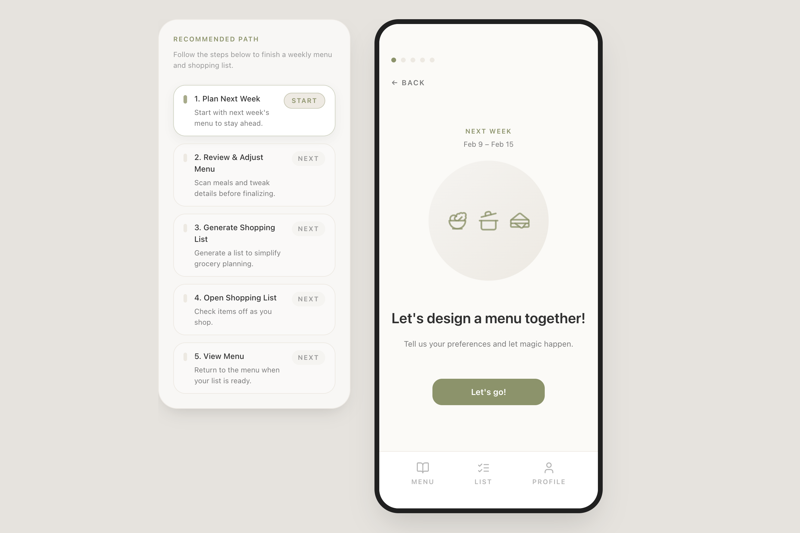
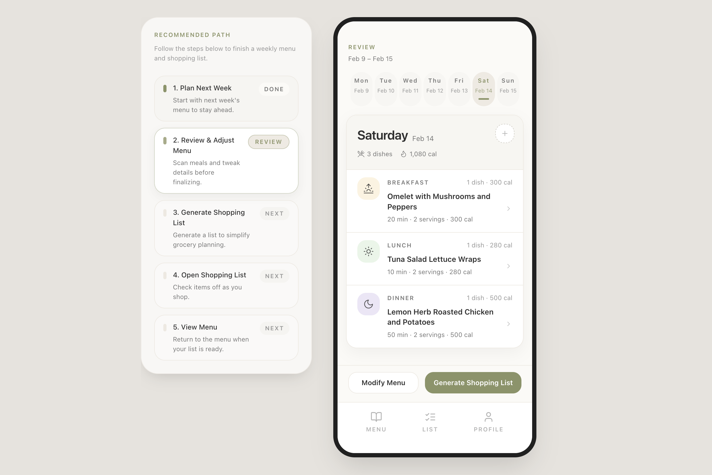
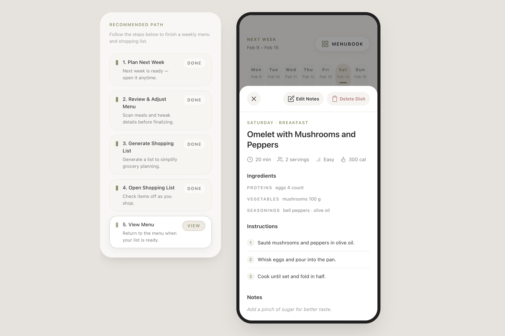
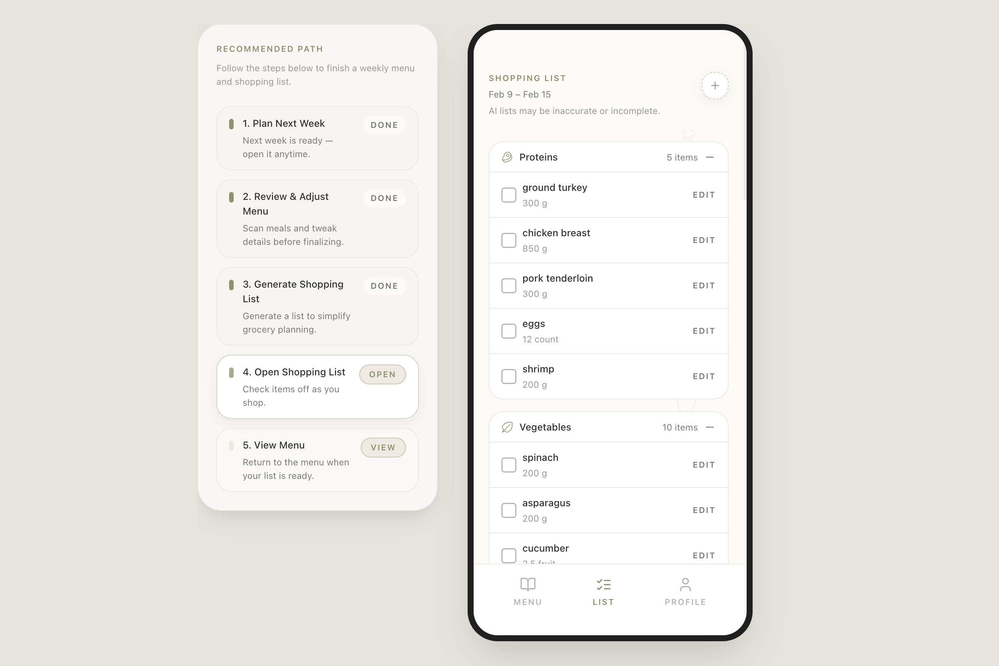

<p align="center">
  
</p>

<h1 align="center">OMenu</h1>
<p align="center"><strong>Planning, Shopping, Cooking for Every Family</strong></p>
<p align="center">AI-powered weekly meal planner built with Gemini 3</p>

<p align="center">
  <a href="https://omenu.vercel.app/">Live Demo</a> ·
  <a href="https://gemini3.devpost.com/">Gemini 3 Hackathon 2026</a>
</p>

---

## Screenshots

<p align="center">
  
  
  
  
</p>

---

## What is OMenu?

OMenu turns a few taps into a complete **Plan → Shop → Cook** loop, powered by Gemini 3. Users express preferences in natural language, pick a weekly schedule, and OMenu generates three deeply linked outputs:

- **Menu Book** — a full week of meals, browsable by day
- **Cooking Handbook** — tap any dish for exact ingredients with quantities matched to your household, step-by-step instructions, cook time, difficulty, and calories
- **Shopping List** — ingredients consolidated across every recipe, categorized, unit-converted, and ready to check off at the store

Ask for a change in plain words and the AI edits only what you asked for. Add a dish manually, and AI never overwrites it; its ingredients go on the shopping list too. The three outputs form a closed loop — not a chat response, but a structured, interactive, persistent application with AI as the engine.

---

## How It Works — The 2.5-Step AI Pipeline

OMenu doesn't send a single prompt to Gemini 3. It runs a **2.5-step orchestrated pipeline** where each step solves a distinct hard problem, and each output precisely constrains the next:

```
Creativity → Structure → Precision
```

**Step 1 — Creative Outline + Draft Shopping List**

Deliberately unstructured — just dish names and ingredient names, no recipes or quantities. This frees Gemini 3 to focus its full reasoning on the multi-constraint optimization: taste, dislikes, budget, people, schedule, nutrition, variety, and ingredient reuse — all at once, within a capped ingredient count (~12–36 items).

**Step 2 — Structured Menu + Cooking Handbook**

Step 1's output locks down the ingredient space. With the "what" decided, Gemini 3 concentrates on the "how" — exact quantities, step-by-step instructions, calorie estimates, cook times. Structured JSON output simultaneously produces the daily cookbook and lays the data foundation for Step 3.

**Step 2.5 — Shopping List Consolidation**

Merging near-duplicates across up to 21 meals, converting heterogeneous units to North American standards, calculating aggregated quantities, and categorizing for grocery-store navigation. Complex enough to need the model's full attention as a dedicated step.

Each step is validated and normalized by a Python layer (valid categories, numeric quantities, servings matching the household; oils, sauces and spices carry no quantity on the shopping list) before reaching the frontend.

---

## Gemini 3 Integration

| Config | Value |
| --- | --- |
| Models | `gemini-3.5-flash-lite` → `gemini-3.1-flash-lite` → `gemma-4-26b-a4b-it` via `google.genai` SDK; the next model is tried when one fails (quota, overload, timeout) |
| Output Mode | `response_mime_type: "application/json"` — native structured output |
| Thinking | `thinking_level: minimal` — optimized for structured output speed |
| Max Output Tokens | 65,536 (Gemma: 32,768) |
| Time Budget | 170 s per request across all attempts, at most `GEMINI_TIMEOUT_SECONDS` per attempt |

---

## Features

- **Natural-Language Preferences** — curated chips spanning diet, cuisine, time, lifestyle, taste, and ingredients, plus free text input
- **AI Menu Generation** — Gemini 3 creates a complete weekly menu respecting all constraints
- **Day-by-Day View** — browse breakfast, lunch, and dinner with swipe navigation
- **Cooking Handbook** — full recipe detail with exact quantities, instructions, time, calories
- **Smart Shopping List** — auto-generated, categorized, consolidated across all recipes
- **Natural-Language Modification** — "make Wednesday dinner vegetarian" triggers minimal AI edits
- **Manual + AI Coexistence** — manually added dishes are never overwritten
- **Multi-Week Support** — create and manage menus for different weeks
- **Guest Mode** — zero-friction onboarding, no login required
- **Responsive Design** — mobile-first with desktop phone-frame layout and guided path panel

---

## Tech Stack

| Layer | Technology |
| --- | --- |
| Frontend | React 18, TypeScript, Vite, Tailwind CSS |
| State | Zustand |
| Routing | React Router v6 |
| Auth & DB | Supabase (PostgreSQL + Auth) |
| AI | Google Gemini 3 API (via Vercel Serverless Functions, Python) |
| Deployment | Vercel |

---

## Architecture

```
User Preferences (natural-language chips + config)
        ↓
React + Vite + Tailwind + Zustand (mobile-first SPA)
        ↓
Serverless Python API (Vercel)
        ↓
┌─────────────────────────────────────────────────────┐
│  GEMINI 3 PIPELINE — Creativity → Structure → Precision  │
│                                                     │
│  Step 1: Creative Outline + Draft Shopping List     │
│       ↓                                             │
│  Step 2: Structured Menu + Cooking Handbook         │
│       ↓                                             │
│  Step 2.5: Shopping List Consolidation              │
└─────────────────────────────────────────────────────┘
        ↓
Validators + Normalizers (Python)
        ↓
Frontend Stores → Supabase Postgres (persistence)
```

---

## Project Structure

```
├── src/                      # React source code
│   ├── components/           # UI components
│   ├── pages/                # Route pages
│   ├── stores/               # Zustand state stores
│   ├── services/             # API & data services
│   ├── utils/                # Helpers and constants
│   └── lib/                  # Supabase client
├── api/                      # Vercel Python serverless functions
│   ├── generate-menu.py
│   ├── generate-shopping-list.py
│   ├── modify-menu.py
│   └── _shared/              # Shared Python modules (request handling, prompts, parser, validators, client)
├── scripts/dev_api.py        # Serves api/ on localhost for `npm run dev`
├── public/                   # Static assets
├── supabase/schema.sql       # Tables and row-level security for Supabase
└── docs/screenshots/         # Images used in this README
```

---

## API Endpoints

| Endpoint | Method | Description |
| --- | --- | --- |
| `/api/generate-menu` | POST | Generate a weekly menu from user preferences (Steps 1 + 2) |
| `/api/modify-menu` | POST | Modify an existing menu with natural-language requests |
| `/api/generate-shopping-list` | POST | Consolidate ingredients into a categorized shopping list (Step 2.5) |

All endpoints require a valid Supabase JWT in the `Authorization` header. Requests outside the app's own limits (1–10 people, $50–500 budget, change requests up to 200 characters, bodies up to 256 KB) are rejected with 400.

---

## Run Locally

Prerequisites: Node 20.19 or newer, Python 3.12, a Supabase project and a Gemini API key.

1. In the Supabase SQL editor, run `supabase/schema.sql`. Under Authentication, enable anonymous sign-ins (used by "Continue as Guest") and add `http://localhost:5173/auth/callback` to the redirect URLs (needed for Google sign-in).
2. Set up the app:

   ```bash
   cp .env.example .env.local   # fill in the Supabase URL, anon key and GEMINI_API_KEY
   npm install
   python3 -m venv .venv && .venv/bin/pip install -r requirements.txt
   ```

3. Start the API functions and the app in two terminals:

   ```bash
   .venv/bin/python scripts/dev_api.py   # API functions on http://127.0.0.1:8000
   npm run dev                           # app on http://localhost:5173, /api is proxied to port 8000
   ```

Tests: `npm test` runs the frontend Vitest suite.

---

## Try It

👉 **[https://omenu.vercel.app](https://omenu.vercel.app/)** — tap "Continue as Guest" to start instantly, no login required.

The demo runs on Gemini's free tier. When the day's quota is used up, generation fails with a quota message until the quota resets the next day.

---

## License

Built for the [Gemini 3 Hackathon 2026](https://gemini3.devpost.com/).
